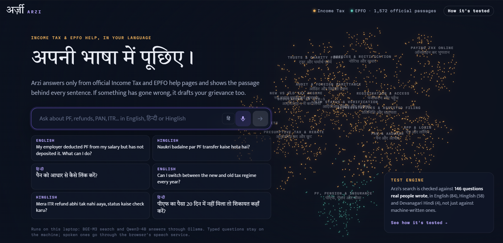
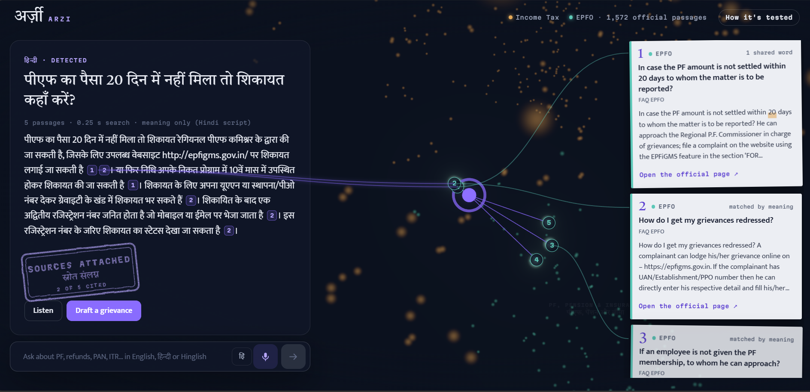
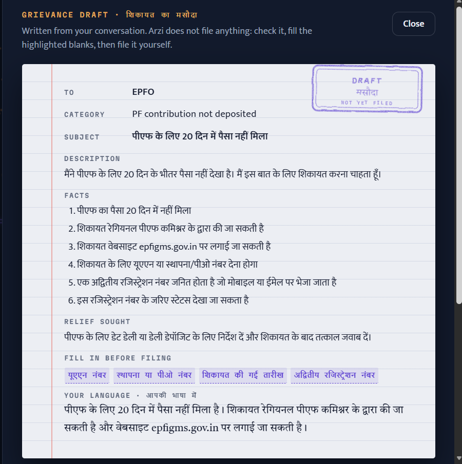
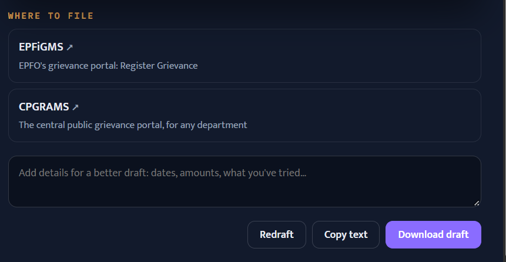

# Arzi (अर्ज़ी): a multilingual citizen grievance assistant

**Problem statement:** `<PS number>` · Multilingual Citizen Grievance Chatbot
**Team:** `<team name>`
**Members:** `<name 1>`, `<name 2>`, `<name 3>`, `<name 4>`

---

## Problem

Citizens with Income Tax or EPFO (provident fund) problems have to search long English help pages,
often while thinking and typing in Hindi or Hinglish. Chatbots that do answer give no way to check
whether the answer is true, and their quality is usually tested on machine-written questions, not on
how real people ask. When something has gone wrong, such as a missing refund or PF that was deducted
but never deposited, the citizen still has to write a formal grievance and find the right portal.

## Our solution

Arzi is a help desk that runs entirely on a laptop:

- **Ask in English, Hindi or Hinglish**, typed or spoken. The language is detected automatically and
  Arzi replies in the same language and script.
- **Grounded answers only.** Every answer comes from 1,572 passages of official Income Tax and EPFO
  help pages, and every sentence cites its passage. A 3D map of all the passages shows where the
  answer came from, with threads linking each citation to its source card and its official page.
- **Grievance drafting.** One click turns the conversation into a formal draft (department,
  category, subject, facts, relief sought), highlights the details the citizen still has to fill in,
  and lists where to file (e-Filing Grievances, EPFiGMS, CPGRAMS). Arzi never files anything itself.
- **A test engine.** Arzi's search is checked against 146 questions real people wrote, in English,
  Hinglish and Hindi. This uses the method from our pre-registered research study, which tests when
  synthetic test questions can be trusted. The `/lab` page shows it: an X-ray of how each search
  method ranks the passages for a question, and the study's results.

## Technology stack

| Layer | Used |
|---|---|
| Language model | Qwen3-4B-Instruct (Q4_K_M) through **Ollama**, run locally |
| Embeddings / search | **BGE-M3** (multilingual dense) + **BM25** (`bm25s`), fused by reciprocal rank fusion; **FAISS** |
| Language detection | Our own Hindi / Hinglish / English classifier (`src/ha/data/langid.py`) |
| Backend | Python 3, **Starlette** + **Uvicorn**, server-sent events for streaming answers |
| Frontend | **React 18**, **Vite**, TypeScript, **Three.js** (react-three-fiber, drei, postprocessing bloom), **GSAP** |
| Voice | Web Speech API (speech recognition in `hi-IN` / `en-IN`, read-aloud) |
| Data prep | scikit-learn (t-SNE, k-means), pandas, NumPy |
| Fonts | Tiro Devanagari Hindi, Mukta, Martian Mono (bundled locally) |
| Research pipeline | bge-reranker-v2-m3, ranx, the `ha` package in `src/` (pre-registered study) |

## Setup

Requirements: Windows 10/11, Python 3.11+, Node.js 22+, [Ollama](https://ollama.com), and an NVIDIA
GPU with 6 GB or more (the app also runs on CPU, more slowly).

```powershell
git clone <repo-url> humanalign-rag
cd humanalign-rag
python -m venv .venv
.venv\Scripts\pip install -r requirements.txt
.venv\Scripts\pip install -e .
copy .env.example .env                 # then edit paths if needed

ollama pull qwen3:4b-instruct-2507-q4_K_M
ollama pull bge-m3
```

The HiAQ corpus (official help pages) and its embeddings are built by the project pipeline into
`data/` and `cache/`. Those folders are not in git; see `docs/` for the build steps.

## Run locally

Double-click **`run_arzi.bat`**. It starts Ollama if needed, builds anything missing, serves the app
and opens **http://127.0.0.1:8765**.

- `/` is the assistant. `/lab` is the X-ray and test results.
- Double-click **`stop_arzi.bat`** to stop it and free the GPU.

Manual start: `.venv\Scripts\python.exe -m uvicorn app.server.server:app --port 8765` (after
`npm install` and `npm run build` in `app/web`). More detail: [`app/README.md`](app/README.md).

## Screenshots

**1. Home.** Ask in English, Hindi or Hinglish. The 3D map on the right is all 1,572 official
passages, grouped into topics with English and Hindi labels.



**2. Answer in Hindi.** A Hindi question about a delayed PF payment. Arzi detects the language,
searches by meaning (Hindi script can't word-match the English pages) and answers in Hindi. Each
citation is threaded through the passage's point in the map to its source card, which links to the
official page.



**3. Grievance draft.** One click turns the conversation into a draft complaint to EPFO, with the
details still needed (UAN, establishment or PPO number, dates) highlighted, and a summary in the
citizen's language.



**4. Where to file.** The right public portals for the department, plus options to add details and
redraft, copy the text or download the draft.



More: [Hinglish answer](app/screenshots/chat-hinglish.png) ·
[English grievance draft](app/screenshots/draft.png) ·
[Lab: X-ray and test results](app/screenshots/lab.png) ·
[Mobile layout](app/screenshots/narrow.png)

## Performance

Measured on the project laptop (6 GB NVIDIA GPU), with all models local.

**Search quality on 146 real citizen questions** (HiAQ pilot: 84 English, 55 Hinglish, 3 Hindi in Roman
script, 4 Hindi in Devanagari). nDCG@10, mean over 5 data splits:

| Search method | nDCG@10 |
|---|---|
| BM25 (word match) | 0.393 |
| Dense, BGE-M3 (meaning match) | 0.516 |
| **Hybrid: BM25 + dense (used by Arzi)** | **0.476** |
| Dense + reranker (best) | 0.551 |

The app runs the hybrid because the reranker can't share the 6 GB GPU with the answer model. On a
larger GPU it would switch to the reranked setup. For a Hindi question in Devanagari, Arzi searches by
meaning only, because those words can't match the English pages.

**Speed**

| Step | Time |
|---|---|
| Search (1,572 passages) | 0.05–0.4 s |
| Full answer, English or Hinglish | about 2–4 s |
| Full answer, Hindi (Devanagari) | about 7–12 s |
| Grievance draft | about 6–7 s |

**Test engine.** On the HiAQ pilot, test sets chosen by our overlap-matching method ranked the search
systems almost as the real questions did (Kendall τ_b 0.92, against 0.81 for random synthetic sets).
Across 8 datasets in the full pre-registered study, the method beat random selection on 6, with
both replications significant on their pooled tests (p = 0.005 and p = 0.001).

**Limits**
- Search is the evaluated part. Answer text comes from a 4B model and can contain mistakes, which is
  why every sentence is cited.
- HiAQ is a small pilot.
- Voice input uses the browser's cloud speech service. Typed questions never leave the machine.

## AI tools disclosure

- **Claude Code (Anthropic, Claude Opus)** was used throughout development: writing and refactoring
  code (backend, frontend, data and figure scripts), drafting documentation and the paper, and
  reviewing results. All outputs were reviewed and run by the team.
- `<add any other tools the team used, e.g. ChatGPT, GitHub Copilot, Cursor>`
- Inside the product, the AI models are Qwen3-4B-Instruct (answers and drafts), BGE-M3 (search) and,
  in the research pipeline, bge-reranker-v2-m3. All are open-weight and run locally.
