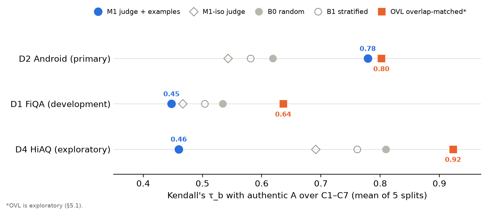

# Does Grounding an LLM Judge in Real Queries Make Synthetic RAG Test Sets Rank Systems Like Real Users? A Pre-registered Study

Draft · 17 Oct 2026 · Chinmai Shetti

## Abstract

Synthetic queries are a cheap way to evaluate retrieval-augmented generation (RAG) systems, but they often rank systems differently from real users' queries. We test whether an LLM judge that sees five similar real user queries can select synthetic queries whose system ranking matches the ranking produced by held-out authentic queries. In a pre-registered study on a single laptop GPU, we generated synthetic queries with Qwen3-4B-Instruct, judged them with and without real-query neighbours, built size-matched query sets, and compared their rankings of seven retrieval configurations with Kendall's τ_b. On the held-out dataset (CQADupStack-Android), the neighbour-grounded set reached τ_b 0.78 against 0.62 for random selection and was higher in all five splits, but the pre-registered paired bootstrap was not significant (p = 0.21), so the primary hypothesis is not supported. On the development dataset (FiQA) and an exploratory pilot on Indian e-government help queries (HiAQ), curation did no better or worse than random. Synthetic queries were longer than real ones and shared far more vocabulary with their source passage (overlap 0.64–0.86 vs 0.30–0.61), which erased dense retrieval's real advantage over BM25. The realism judge did not penalise this copying. In an exploratory follow-up specified before it was run, simply sampling synthetic queries to match the passage-overlap distribution of the real example queries beat random selection on all three datasets (+0.10 to +0.18 τ_b), without any LLM judge. Two pre-registered replications on five fresh datasets supported this on their pooled tests (R1: +0.06, p = 0.005; R2: +0.06, p = 0.001), but the gain held only on the three CQADupStack forums (+0.14 to +0.17); on NFCorpus it was absent and on SciFact it reversed (−0.14). We release the pre-registration, code and run registry.

## 1 Introduction

Evaluating a RAG system needs test queries, and real user queries are often unavailable, private or too few. LLM-generated queries fill the gap, but they differ from real ones: they are longer, more formal and closer to the wording of the documents they were generated from [Kucia & Gawlik 2026; Rahmani et al. 2025]. When the purpose of a test set is to choose between systems, what matters is whether the synthetic set ranks systems the way real users would.

We ask whether that ranking agreement can be improved by curation rather than generation. Our idea is to show an LLM judge a handful of real user queries for similar needs and ask it to rate how realistic each synthetic query is, then keep the most realistic ones. A similar grounding idea has been used to judge the relevance of results [Vardasbi et al. 2026]; here it is applied to the realism of queries and validated by system-ranking agreement.

The study was pre-registered before any result was seen. Its primary test (H2) asks whether the neighbour-grounded set ranks seven retrieval configurations more like the held-out authentic queries than random and topic-matched synthetic sets do. A key secondary test (H3) isolates the contribution of the real neighbours.

**Contributions.**
- A pre-registered, fully local pipeline for curating synthetic query sets with a neighbour-grounded realism judge, evaluated by ranking agreement with held-out authentic queries.
- A null result on the primary test, with consistent positive point estimates on the held-out dataset and negative ones elsewhere.
- A mechanism: synthetic queries copy their source passage's vocabulary, which inflates BM25 relative to dense retrieval, and realism judging does not correct it.
- HiAQ, a corpus of Indian Income Tax and EPFO help pages with 150 everyday scenarios and collected queries in English, Hinglish and other Indian languages, reported as a pilot.
- An exploratory, pre-specified alternative: overlap-matched sampling, which beat random selection on all three datasets and needs no LLM, followed by two pre-registered replications on five fresh datasets (both supported when pooled; consistent on CQADupStack forums, absent or reversed on NFCorpus and SciFact).

## 2 Related work

**Synthetic versus authentic queries.** Kucia & Gawlik (2026) show that synthetic RAG queries are shorter and draw on far fewer sources than authentic ones, and that the best configuration under synthetic queries is not the best under authentic ones; they diagnose the gap but do not curate. Rahmani et al. (2024) find that synthetic TREC DL queries can reproduce system rankings (τ = 0.815) but that τ drops to 0.157 when only the source passage is judged relevant, the sparse-judgement setting our synthetic sets also use. Rahmani et al. (2025) report that LLM queries are longer and LLM relevance judges are lenient. Hussain & Nielbo (2026) show synthetic queries misleading production routing decisions. van Elburg et al. (2025) find that synthetic QA benchmarks rank RAG systems with different retrievers reliably but not systems with different generators. Abdalla et al. (2026) measure the share of synthetic query words found in the source document and report it higher than for official queries on all four of their tasks, up to 0.36 vs 0.10.

**Grounded LLM judges.** Vardasbi et al. (2026) ground an LLM relevance judge in summaries of historical interactions with similar queries, the closest analogue to our neighbour grounding, but they judge the relevance of results rather than the realism of queries and do not build test sets. MAPLE (Wei et al. 2026) grounds query generation in retrieved examples and uses an LLM human-likeness score as an evaluation metric; we use realism as a selection criterion and validate it by ranking agreement. MirrorBench (Hathidara et al. 2026) calibrates human-likeness judges for conversational user proxies.

**Code-mixed and Indian-language search.** Public evaluation data for Romanised-Hindi and Hinglish public-service queries is scarce; existing code-mixed search benchmarks are hand-authored and e-commerce focused. HiAQ adds scenario-elicited e-government help queries, here only as a pilot.

## 3 Method

**Pre-registration.** The hypotheses, datasets, configurations, selection rules and statistical test were frozen before any result (git tag `prereg-v1`, 27 Sep 2026). Three dated amendments followed before the data they affect existed: A1 moved the primary test to the held-out dataset alone after authentic HiAQ collection fell short of 300 queries; A2 reduced the calibration set; A3 dropped human calibration, fixing the judge's original prompt and equal score weights. The analysis is therefore prereg-v3. All pipeline settings were recorded in a signed freeze file before the held-out queries were opened.

**Datasets.**

| ID | Dataset | Role | Passages | Authentic queries | R / A per split |
| --- | --- | --- | --- | --- | --- |
| D1 | FiQA-2018 (BEIR) | development | 57,638 | 648 | 260 / 388 |
| D2 | CQADupStack-Android (BEIR) | held-out, primary | 22,998 | 699 | 279 / 420 |
| D4 | HiAQ (Income Tax + EPFO help pages) | exploratory pilot | 1,572 chunks | 146 collected | 57 / 89 |

Authentic queries are split five times (seeds 0–4) into R (40%), whose queries the judge may see, and the test set A (60%), stratified by language class and topic cluster. Language classes (English, Romanised Hindi, Hinglish, Devanagari Hindi) come from a rule-based token-level identifier with the code-mixing index of Das & Gambäck (2014).

**Synthetic pools.** Qwen3-4B-Instruct (Q4_K_M; Qwen Team 2025) generated queries from 800 sampled passages per dataset with a standard and a persona template (temperature 0.7, top-p 0.9), filtered and deduplicated (cosine 0.95). The pool U holds 1,443 (D1), 1,295 (D2) and 1,231 (D4) queries. Synthetic queries are judged relevant only to their source passage.

**Neighbour-grounded judge.** For each synthetic query and split, BGE-M3 (Chen et al. 2024) retrieves the top 30 queries from R, reranked to the top 5 with bge-reranker-v2-m3. The same Qwen3-4B model rates the query from 1 to 5 on fidelity to its passage (F), human-likeness (H), natural specificity (S), need plausibility (P) and code-mix naturalness (C), with the five neighbours shown in two permuted orders (a third on disagreement ≥ 2; median per dimension), temperature 0. M1-iso is the same judge without neighbours.

**Query sets.** Every set for a dataset and split has size N = min(|A|, number passing each judge's gate); N = 388 (D1), 420 (D2) and 89 (D4) in every split. B0 draws N queries at random; B1 draws at random within k-means strata of R with proportional quotas (20 draws each). M1 and M1-iso keep queries with F ≥ 4 and select greedily by the equal-weight score H + S + P + C* within the same strata, skipping queries with cosine > 0.90 to one already chosen; ties are broken by a seeded random key.

**Evaluation.** Seven configurations are compared: two BM25 settings (bm25s; Lù 2024), BGE-M3 dense, BM25 + dense reciprocal-rank fusion, and each first stage reranked by bge-reranker-v2-m3. Each set scores a configuration by mean nDCG@10 (ranx; Bassani 2022), and agreement is Kendall's τ_b between the set's and A's seven scores (B0 and B1 averaged over draws). H2 holds if τ_b(M1, A) exceeds both τ_b(B0, A) and τ_b(B1, A) in a one-sided paired bootstrap (1,000 resamples of queries, seed 20260927, intersection-union test at α = 0.05), averaged over the five splits.

**Compute.** Everything ran locally on one RTX 3050 laptop GPU (6 GB) with Ollama; about 27,700 judge calls in total, with no failures.

## 4 Results

The primary hypothesis is not supported: on the held-out dataset the neighbour-grounded set agreed best with authentic queries in every split, but not significantly.

**Table 1.** Seed-averaged τ_b between each set's and authentic A's ranking of C1–C7 (95% bootstrap CI). D2 is the pre-registered test; D1 is development; D4 is exploratory. (`tables/table1_tau.csv`)

| Set | D2 Android (primary) | D1 FiQA (development) | D4 HiAQ (exploratory) |
| --- | --- | --- | --- |
| M1 (judge with neighbours) | **0.779** (0.48–0.79) | 0.448 (0.35–0.56) | 0.460 (0.02–0.56) |
| M1-iso (judge alone) | 0.543 (0.33–0.66) | 0.467 (0.33–0.54) | 0.691 (0.31–0.69) |
| B0 (random) | 0.619 (0.54–0.63) | 0.534 (0.44–0.59) | 0.810 (0.58–0.75) |
| B1 (stratified random) | 0.581 (0.51–0.59) | 0.504 (0.41–0.57) | 0.761 (0.52–0.69) |

**Figure 1.** τ_b with authentic A for each query set; OVL is exploratory (§5.1). Runs P5-eval-dev-fiqa-20261016T104019-aed308, P5-eval-heldout-cqa_android-20261016T110347-f9f1b6, P5-eval-exploratory-hiaq-20261017T064411-f305b8 and the EXP-v2 runs.

**H2 (D2).** Δ̄(M1 − B0) = +0.160 (95% CI −0.122 to 0.219), p = 0.211; Δ̄(M1 − B1) = +0.198 (−0.085 to 0.255), p = 0.106. H2 required both p < 0.05 and is not supported. M1's point estimate exceeded B0's in all five splits (0.81/0.63, 0.71/0.58, 0.78/0.59, 0.81/0.70, 0.78/0.60). It also had the highest AP correlation τ_AP (Yilmaz et al. 2008) (0.66 vs 0.51 for B0) and top-3 overlap (0.93 vs 0.76).

**H3 (D2).** Δ̄(M1 − M1-iso) = +0.236 (−0.070 to 0.370), p = 0.079; not supported at α = 0.05.

**H1.** Raw synthetic queries differ from authentic ones. With Holm correction over nine tests, length (D1: 14.6 vs 11.1 words; D2: 16.9 vs 9.0) and gold-passage overlap differ on both datasets, and topic distribution differs on D1 only (D2: p = 0.047 before correction). Random synthetic sets reach τ_b 0.53 (D1) and 0.62 (D2), below the 0.8 threshold on both, so H1's ranking criterion is met. H4 (per-language gaps on HiAQ) was not estimable under amendment A1.

**Development and pilot.** On D1, M1 trailed random (Δ̄ = −0.087, p = 0.96). On the HiAQ pilot, M1 trailed random in all five splits (Δ̄ = −0.350, CI −0.629 to −0.131).

**Absolute scores.** Synthetic sets inflate nDCG@10 by about 0.40 (D1), 0.52 (D2) and 0.28 (D4) relative to authentic queries, so they are unsuitable for absolute effectiveness estimates whichever selector is used.

## 5 Analysis: why curation fell short

The dominant difference between synthetic and authentic sets is vocabulary copied from the gold passage, and the realism judge does not correct it (exploratory, after the freeze).

**Table 2.** Seed means. Overlap = share of a query's content words found in its gold passage. Lexical advantage = nDCG@10 of BM25 (C1) minus dense (C3). (`tables/table2_overlap.csv`)

| Measure | D1 FiQA | D2 Android | D4 HiAQ |
| --- | --- | --- | --- |
| Overlap: authentic A | 0.54 | 0.61 | 0.30 |
| Overlap: B0 / M1 | 0.64 / 0.70 | 0.84 / 0.86 | 0.80 / 0.73 |
| Lexical advantage: authentic A | −0.17 | −0.11 | −0.12 |
| Lexical advantage: B0 / M1 | −0.03 / +0.01 | −0.04 / −0.03 | −0.08 / +0.03 |
| Spearman ρ, judge score vs overlap | 0.11 | 0.14 | −0.03 |

Authentic queries favour dense retrieval over BM25 by 0.11–0.17 nDCG@10, the largest single difference in the authentic rankings. Synthetic queries reuse their passage's words, so BM25 catches up and the two are roughly tied; any synthetic set therefore misorders the most important system pairs. On D1 and D2 the judge's score rises slightly with overlap, so M1 selects the most passage-like queries. Neighbour grounding lowers the judge's human-likeness scores (on D1, mean H falls from 4.52 to 3.74), but it does not make the judge sensitive to lexical leakage.

On D2 all synthetic sets sat near the nDCG ceiling (0.93–0.99), so the rankings turn on tiny differences. In split 0, for example, B0 ranks the reranked BM25 run (C6) first, while M1 and the authentic queries both place it fifth. On HiAQ, M1's tilt towards BM25 is not explained by overlap, since its selected queries overlap less than random ones; we leave the cause open.

### 5.1 A judge-free alternative (exploratory)

If lexical leakage drives the ranking errors, selecting for the overlap of real queries should help more than selecting for realism. We specified two judge-free selectors and recorded them before running either on any dataset, then ran them unchanged on all three.

- **OVL (overlap-matched):** split the real example queries R (never A) into five equal-frequency bands of gold-passage overlap, and fill the same band shares with randomly drawn synthetic queries (20 draws).
- **NN (nearest-to-real):** rank synthetic queries by mean cosine to their five nearest real example queries and select with the M1 procedure.

**Table 3.** Seed-averaged τ_b with authentic A (exploratory). (`tables/table3_v2.csv`)

| Dataset | B0 | B1 | M1 | OVL | NN |
| --- | --- | --- | --- | --- | --- |
| D1 FiQA | 0.534 | 0.504 | 0.448 | **0.636** | 0.467 |
| D2 Android | 0.619 | 0.581 | 0.779 | **0.802** | 0.562 |
| D4 HiAQ | 0.810 | 0.761 | 0.460 | **0.923** | 0.733 |

OVL beat random selection on every dataset: Δ̄(OVL − B0) = +0.102 (95% CI 0.094–0.130), +0.183 (0.120–0.228) and +0.113 (0.070–0.170), each p < 0.001. It beat the realism judge on D1 (+0.19) and D4 (+0.46) and matched it on D2 (+0.02, p = 0.09). NN was no better than random anywhere, so resembling real queries in embedding space is not what matters.

OVL matched R's overlap on D1 but only partly on D2 and D4, where too few low-overlap synthetic queries existed (its overlap was 0.74–0.76 vs 0.61–0.64 on D2 and 0.43–0.47 vs 0.28–0.30 on D4). A generator that copies less would give the selector more to work with. Because the idea came from a post-freeze diagnosis that looked at the test sets, this result is hypothesis-generating and needs a fresh dataset to confirm.

### 5.2 Pre-registered replication on fresh datasets (R1)

We pre-registered a replication before downloading two datasets the project had never used (`docs/replication_prereg.md`, D-069; one clarification, D-070, also recorded before download): D5 CQADupStack-Webmasters (17,405 passages, 506 test queries) and D6 NFCorpus (3,633 passages, 323 test queries). The frozen pipeline was reused unchanged, without LLM judging. R1 states that, pooled over D5 and D6, τ_b(OVL, A) exceeds both τ_b(B0, A) and τ_b(B1, A), tested with the same paired bootstrap and intersection-union rule as H2. All selected sets and synthetic-query runs were hashed and committed before the test queries were unsealed, and the evaluation ran once.

**Table 4.** Replication R1: seed-averaged τ_b and Δ̄ with 95% bootstrap CIs. (`tables/table4_r1.csv`; run R1-20261017T194854-d1b74e)

| Dataset | OVL | B0 | B1 | Δ̄(OVL − B0) | Δ̄(OVL − B1) |
| --- | --- | --- | --- | --- | --- |
| D5 Webmasters | **0.529** | 0.381 | 0.332 | +0.148 (0.074 to 0.185) | +0.197 (0.099 to 0.205) |
| D6 NFCorpus | 0.594 | 0.619 | 0.628 | −0.025 (−0.070 to 0.020) | −0.034 (−0.104 to 0.029) |
| **Pooled (R1 test)** | | | | **+0.062 (0.016 to 0.091), p = 0.005** | **+0.081 (0.015 to 0.102), p = 0.004** |

R1 is supported: both pooled comparisons are significant. The effect is not uniform, though. On D5, OVL beat both baselines in all five splits; on D6 it did not differ from random. NFCorpus test queries have 38.2 relevant passages on average against 2.8 for Webmasters, so we tested whether this density explains the null: re-scoring NFCorpus's authentic queries with a single relevant passage each did not produce a gain (Δ̄(OVL − B0) = −0.026, p = 0.28; exploratory, specified in advance in D-071).

**Second replication (R2).** A second protocol, registered before download (`docs/replication2_prereg.md`, D-072), repeated R1 unchanged on D7 SciFact (5,183 passages, 300 test queries), D8 CQADupStack-Mathematica and D9 CQADupStack-Programmers (16,705 and 32,176 passages; 700 of 804 and 876 test queries sampled by the existing builder rule).

**Table 5.** Replication R2: seed-averaged τ_b and Δ̄ with 95% bootstrap CIs. (`tables/table5_r2.csv`; run R2-20261019T001603-e7e628)

| Dataset | OVL | B0 | B1 | Δ̄(OVL − B0) | Δ̄(OVL − B1) |
| --- | --- | --- | --- | --- | --- |
| D7 SciFact | 0.536 | **0.677** | 0.663 | −0.141 (−0.131 to −0.043) | −0.127 (−0.120 to −0.036) |
| D8 Mathematica | **0.871** | 0.731 | 0.773 | +0.140 (0.017 to 0.144) | +0.098 (0.017 to 0.117) |
| D9 Programmers | **0.628** | 0.457 | 0.437 | +0.170 (0.135 to 0.202) | +0.190 (0.148 to 0.218) |
| **Pooled (R2 test)** | | | | **+0.057 (0.025 to 0.085), p = 0.001** | **+0.054 (0.032 to 0.082), p < 0.001** |

R2 is supported, with the same split as R1: OVL beat both baselines in all five splits of both CQADupStack forums, and lost to both in all five splits of SciFact. We had expected SciFact, with about one relevant passage per query, to favour OVL; it did not, which again argues against judgement density as the explanation. Across the five fresh datasets, OVL helped on every CQADupStack forum (Webmasters, Mathematica, Programmers) and not on NFCorpus or SciFact. A difference we did not test: in those two collections the authentic queries are not user questions (NutritionFacts page titles and scientific claims), while our generator writes questions. The manipulation itself worked on both: OVL's overlap (0.68–0.69 on D5, 0.63–0.66 on D6) was much closer to the real example queries' (0.54–0.59, 0.54–0.64) than random sets' (0.80, 0.72–0.75).

### 5.3 Robustness checks (exploratory, D-071)

- **Other metrics.** With MRR@10, Recall@100 or Hit@5 in place of nDCG@10, OVL still beat random selection on D1, D2 and D4 under every metric (Δ̄ +0.03 to +0.19, p ≤ 0.003). The realism judge was not significantly better than random under MRR@10 or Hit@5 on any dataset (its point estimates were positive only on D2).
- **Single judge dimensions.** Selecting by fidelity, human-likeness, specificity or plausibility alone never beat random. On HiAQ, human-likeness alone was the worst selector (τ_b 0.22 vs 0.81 for random), so the human-likeness judgement is what drove M1's failure there.

## 6 Discussion and limitations

Realism, as an LLM judges it, is not the property that makes a synthetic test set rank systems correctly. A query can read like a real user's and still copy its answer passage's vocabulary, and that copying decides which retrievers win. Curation aimed at ranking fidelity should target lexical leakage directly, for example by matching the overlap distribution of authentic queries, or should pair synthetic queries with pooled rather than source-only relevance judgements, which Rahmani et al. (2024) found decisive. Our overlap-matched selector (§5.1) is a first step in that direction: it held up in two pre-registered replications when pooled (§5.2), but only on the CQADupStack forums among the five fresh datasets, so its benefit is not universal, and relevance-judgement density does not explain where it fails.

The held-out result is a pre-registered null with consistent positive point estimates. We report it as such and do not claim an improvement. The development and pilot results point the other way, so the D2 pattern should not be generalised without replication.

**Limitations.**
- **No human calibration** (A3): the judge's realism scores were never validated against human ratings, and its score weights are equal by design.
- **Same model generates and judges,** which may favour its own style; M1-iso is the only control.
- **Sparse relevance labels:** synthetic queries count only their source passage as relevant.
- **Low power:** τ_b over seven systems moves in large steps; on D2 synthetic scores sit near the ceiling. Resampling such sets also breaks near-ties and pulls bootstrap τ values down, so some point estimates lie at or above their percentile interval (Table 1).
- **One held-out dataset** carries the primary test (A1).
- **Pools:** only 6 of 16 synthetic pools reached 90% of their size target; they were kept as generated.
- **HiAQ** queries were compiled by the team and accepted on the project lead's statement, not collected through the planned survey; the 146-query pilot is exploratory and its single-chunk relevance labels are sparse.

## 7 Ethics and reproducibility

**Ethics.** The faculty advisor gave informal approval for the HiAQ data collection. No personal identifiers were collected, and phone numbers, email addresses, Aadhaar-like numbers and PAN were stripped at import (none occurred). HiAQ pages were crawled within robots.txt and each site's published policy at one request every two seconds; sources that forbid automated access or reproduction were excluded.

**Reproducibility.** All models run locally with pinned digests (Qwen3-4B-Instruct-2507 Q4_K_M, BGE-M3, bge-reranker-v2-m3), and the code refuses to run on a digest mismatch. Every reported number is a row in a results registry with its run ID and git commit. The pre-registration, its three amendments, the signed freeze record (hashes of every pool, judgement, selected set and retrieval run) and the decision log are released with the code.

## References

- Abdalla, Abdallah, Sedek & Jatowt 2026. OBLIQ-IR: Training a Dense Retriever for Oblique Queries. EMNLP 2026. [arXiv 2609.29649](https://arxiv.org/abs/2609.29649)
- Bassani 2022. ranx: A Blazing-Fast Python Library for Ranking Evaluation and Comparison. ECIR 2022, pp. 259–264. [doi:10.1007/978-3-030-99739-7_30](https://doi.org/10.1007/978-3-030-99739-7_30)
- Chen, Xiao, Zhang, Luo, Lian & Liu 2024. M3-Embedding: Multi-Linguality, Multi-Functionality, Multi-Granularity Text Embeddings Through Self-Knowledge Distillation. [arXiv 2402.03216](https://arxiv.org/abs/2402.03216)
- Das & Gambäck 2014. Identifying Languages at the Word Level in Code-Mixed Indian Social Media Text. ICON 2014, pp. 378–387. [ACL Anthology W14-5152](https://aclanthology.org/W14-5152/)
- Hathidara et al. 2026. MirrorBench. KDD '26 D&B. [arXiv 2601.08118](https://arxiv.org/abs/2601.08118)
- Hussain & Nielbo 2026. The Coverage Illusion. [arXiv 2605.27220](https://arxiv.org/pdf/2605.27220)
- Kucia & Gawlik 2026. Beyond Benchmark Scores: How Synthetic and Authentic Query Distributions Diverge in RAG Evaluation. CIKM '26. [arXiv 2609.14579](https://arxiv.org/abs/2609.14579)
- Lù 2024. BM25S: Orders of Magnitude Faster Lexical Search via Eager Sparse Scoring. [arXiv 2407.03618](https://arxiv.org/abs/2407.03618)
- Qwen Team 2025. Qwen3 Technical Report. [arXiv 2505.09388](https://arxiv.org/abs/2505.09388)
- Rahmani et al. 2024. Synthetic Test Collections for Retrieval Evaluation. SIGIR '24. [arXiv 2405.07767](https://arxiv.org/abs/2405.07767)
- Rahmani et al. 2025. Bias in Synthetic Data. CIKM '25. [arXiv 2506.10301](https://arxiv.org/pdf/2506.10301)
- Thakur et al. 2021. BEIR: A Heterogeneous Benchmark for Zero-shot Evaluation of Information Retrieval Models. NeurIPS Datasets and Benchmarks.
- van Elburg, van der Putten & Marx 2025. Can we Evaluate RAGs with Synthetic Data? SynDAiTE workshop, ECML-PKDD 2025. [arXiv 2508.11758](https://arxiv.org/abs/2508.11758)
- Vardasbi et al. 2026. As It Was. SIGIR '26. [arXiv 2607.01040](https://arxiv.org/abs/2607.01040)
- Wei et al. 2026. MAPLE / MAPLE-Synth. [arXiv 2608.15624](https://arxiv.org/pdf/2608.15624)
- Yilmaz, Aslam & Robertson 2008. A New Rank Correlation Coefficient for Information Retrieval. SIGIR 2008, pp. 587–594. [doi:10.1145/1390334.1390435](https://doi.org/10.1145/1390334.1390435)

Second novelty check (17 Oct 2026, `docs/novelty_check.md`): no work found that curates synthetic query sets for system-ranking fidelity, or selects them by matching authentic passage overlap.
